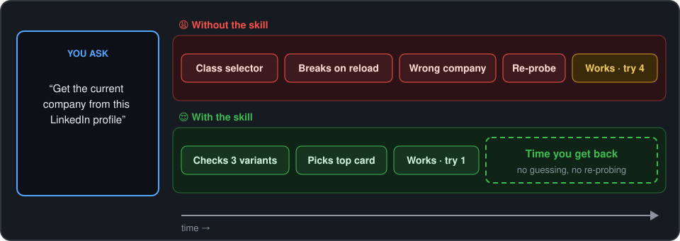

# 🔗🕵️ LinkedIn AI Skill


> An AI agent skill that reads data out of logged-in LinkedIn pages reliably, even as LinkedIn reshuffles its markup on every load.

[](LICENSE.txt) [](https://github.com/anthropics/skills) [](https://github.com/adriangrantdotorg/linkedin-ai-skill/releases) [](https://github.com/adriangrantdotorg/linkedin-ai-skill/pulls)

---

## ⬇️ Why Install?

- 🎯 **Right company, first try** — never grabs a feed post or school by mistake
- 📚 **"Read in full" means it** — every profile section and feed tab, counted
- 💸 **$0 added cost** — runs inside the AI you already use
- 🧩 **No setup** — one Markdown file, no packages, no build

| | 😩 Without this Skill | 😌 With this Skill |
| --- | :---: | :---: |
| 🔁 Tries until it works | 🧪 ~4 | **1** |
| 🧭 Page layouts handled | 🧪 1 | **3** |
| 📋 Profile sections checked | 🧪 2 | **13** |
| 📦 Packages to install | 🧪 a scraping library | **none** |

<sub>🧪 estimate</sub>

---

## ✨ Features

The skill starts from one fact most AIs miss: LinkedIn serves a different layout of the same page on each load, so it checks every known variant, picks by position rather than class name, and tests fixes on fresh loads.



- 🏢 **Current employer from any profile** — all three top-card layouts, plus an API fallback
- 📚 **Whole profiles and feeds, provably read** — every details page, all three activity tabs, interests lists
- 💼 **Jobs data, rendered or not** — stable job-card anchors, plus descriptions, websites and open roles
- 💬 **A person's comments, linked exactly** — the post and the direct link to each comment
- 🤝 **Who you know at a firm** — mutual connections and 2nd-degree staff, past and present
- 🔌 **A straight answer on LinkedIn connectors** — what exists today, and the two routes that work
- 🔗 **Link checks that don't cry wolf** — a 403 or 999 from LinkedIn isn't a dead link

---

## 🚀 Installation

Needs an AI assistant that supports [Agent Skills](https://github.com/anthropics/skills) and a Chromium browser it can drive, signed in to LinkedIn (for example Claude in Chrome). For AppleScript that drives Chrome on a Mac, turn on **View ▸ Developer ▸ Allow JavaScript from Apple Events**.

```bash
# Claude Code
git clone https://github.com/adriangrantdotorg/linkedin-ai-skill.git ~/.claude/skills/linkedin-ai-skill
# Cursor
git clone https://github.com/adriangrantdotorg/linkedin-ai-skill.git ~/.cursor/skills/linkedin-ai-skill
# ChatGPT & Codex
git clone https://github.com/adriangrantdotorg/linkedin-ai-skill.git ~/.agents/skills/linkedin-ai-skill
```

| **Platform** | **Skills folder** |
| --- | --- |
| **[Claude Code](https://code.claude.com/docs/en/skills)** | `~/.claude/skills/` |
| **[Cursor](https://cursor.com/docs/skills)** | `~/.cursor/skills/` |
| **[ChatGPT & Codex](https://learn.chatgpt.com/docs/build-skills)** | `~/.agents/skills/` |

---

## 💡 Usage

Ask for LinkedIn data as usual; the skill kicks in on its own.

| You say | The skill makes |
| --- | --- |
| "Get the current company from this LinkedIn profile." | A **JavaScript scraper** that checks every layout and returns the top-card company |
| "Read everything on this person's profile and activity." | A **full read** of every section and tab, with empty ones marked and posts counted |
| "Who do I know at Acme Partners, and who used to work there?" | A **list of 2nd-degree people**, each with their role at the firm and shared connections |

---

<div align="center">
  <sub>Built with ❤️ for the AI automation community & everyone tired of broken selectors ✌🏾</sub>
</div>
